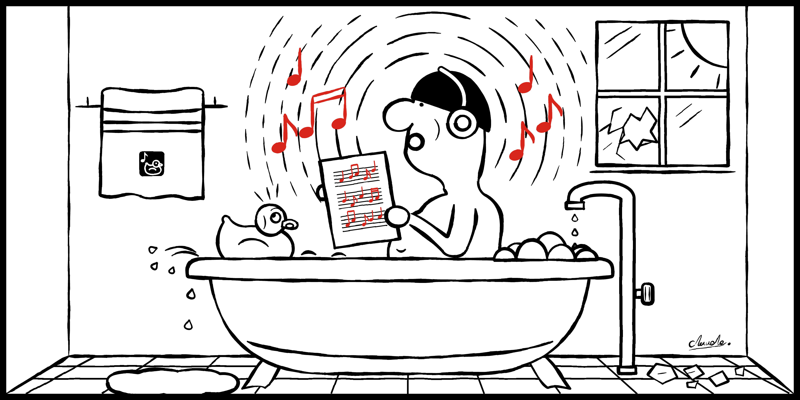
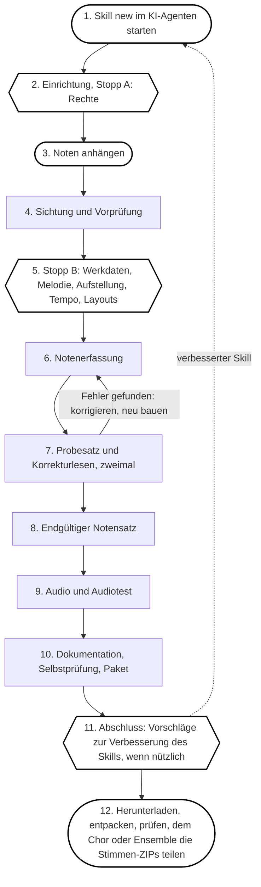

<p><a href="https://practice-duck-plugin.pages.dev/de/"></a></p>

# practice-duck

<p><picture><source media="(prefers-color-scheme: dark)" srcset="img/header-dark.png"></picture></p>

[English](README.md) | Deutsch

## Eine Partitur. Übematerial für jede Stimme.

Das ist vor allem ein Code-Experiment.

Das Projekt dokumentiert einen KI-Musik-Workflow als Claude-Plugin. Aus der Partitur eines **Chors oder eines Instrumentalensembles** (PDF, Scan, Foto, MusicXML oder Export aus einer Notensatzsoftware) erzeugt das Plugin ein ZIP mit **Noten und MP3-Aufnahmen für jede Stimme**: in drei Stufen (solo, mit Begleitung, zusammen mit den anderen Stimmen) und in zwei Klängen (Chor bzw. Instrument und Klavier). Der KI-Agent überträgt die Noten, korrigiert sie zweimal und prüft das Audio technisch. Zwölf Skills decken den ganzen Weg ab: vom ersten Lauf über Korrekturen und Transponieren bis zur Übergabe.

**Inhalt**

[A. Überblick: Was macht der Skill?](#a-überblick-was-macht-der-skill)<br>
[B. Start: Wie legst du los?](#b-start-wie-legst-du-los)<br>
[C. Voraussetzungen: Was wird benötigt?](#c-voraussetzungen-was-wird-benötigt)<br>
[D. Rechte: Was fragt der Skill ab?](#d-rechte-was-fragt-der-skill-ab)<br>
[E. Ablauf: Welche Schritte gibt es?](#e-ablauf-welche-schritte-gibt-es)<br>
[F. Spielraum: Ist der Ablauf verbindlich?](#f-spielraum-ist-der-ablauf-verbindlich)<br>
[G. Ergebnis: Was kommt heraus?](#g-ergebnis-was-kommt-heraus)<br>
[H. Audio-Mix: Wie werden die Aufnahmen gemischt?](#h-audio-mix-wie-werden-die-aufnahmen-gemischt)<br>
[I. Grenzen: Was kann er nicht?](#i-grenzen-was-kann-er-nicht)<br>
[J. KI-Kennzeichnung: Wie werden KI-Inhalte markiert?](#j-ki-kennzeichnung-wie-werden-ki-inhalte-markiert)

## A. Überblick: Was macht der Skill?

Ein ZIP mit
- Übe-Audio (MP3) und MIDI je Stimme: allein, mit Begleitung, im Chor oder Ensemble, plus Tutti; in Chor- oder Ensembleklang und in Klavierklang; normal und verlangsamt
- Tags in jeder MP3 und einem Albumcover je Stück, für alle Stimmen gleich (Farben aus Tonart, Tongeschlecht, Tempo und Takt abgeleitet)
- einer fertigen ZIP-Datei je Stimme, einer Anleitung für die Leitung von Chor oder Ensemble, einem Prüf- und einem Korrekturprotokoll
- einer Startseite (`Start.html`) im Paket und in jedem Stimmenordner: Aufbau mit Links, die gewählten Layouts mit Vorschau und in jedem Stimmenordner zwei Player (Liste der Aufnahmen mit Cover, Kopfhörer). Sie läuft per Doppelklick, ohne Server

Den genauen Aufbau des ZIPs zeigt Abschnitt [G](#g-ergebnis-was-kommt-heraus).

**Chor und Instrumente.** Derselbe Weg gilt für gemischte Chöre, andere Vokalensembles und Instrumentalstücke: Streichquartett, Holzbläserquintett, Blechbläserquintett, Solostimme oder Soloinstrument mit Klavier oder ein eigenes Ensemble. Transponierende Instrumente (Klarinette in B, Horn in F und andere) stehen in notierter Tonhöhe im Notenbild, die Aufnahmen klingen in klingender Tonhöhe. Eine gedruckte Klavier- oder Orgelbegleitung wird mitgenommen und, wenn die Partitur keine hat, aus den Stimmen entworfen. Ein Instrumentalstück kommt als `Instrument_Uebungen_<Titel>`, ein Chorstück als `Uebungen_<Titel>`.

**Die Skills des Plugins**

| Skill | Was er macht |
|---|---|
| `new` | Der ganze Weg von der Partitur bis zum fertigen ZIP, mit zwei Stopps, an denen du entscheidest (Rechte; Titel, Stimmen, Tempo, Layouts) |
| `setup` | Prüft und installiert die Werkzeuge (Audio, Notensatz, PDF) |
| `rights` | Klärt die Rechte einer Partitur, bevor etwas entsteht |
| `profile` | Hält wiederkehrende Wünsche (Audio, Paket, Dokumente) in einem Profil fest, eingestellt auf einer Startseite |
| `ensemble` | Legt das Ensemble an oder ändert es: Stimmen, Schlüssel, Instrumente, Transposition, aus einer Vorlage |
| `import` | Startet von einer MusicXML-Datei oder von Fotos statt von einem PDF-Scan |
| `adapt` | Transponiert ein fertiges Stück oder überträgt es auf ein anderes Ensemble |
| `correct` | Korrigiert einzelne Takte oder Stimmen und baut das Stück neu |
| `check` | Prüft ein fertiges Paket: Prüfprotokoll und Hörliste |
| `deliver` | Packt das Paket für die Übergabe: Papierformat, Sprache, ZIP je Stimme |
| `continue` | Setzt einen Lauf aus seiner Sitzungsübergabe fort |
| `help` | Erklärt das Plugin und findet die Ursache eines Problems |

## B. Start: Wie legst du los?
1. Lade die Datei `practice-duck.plugin` aus dem [neuesten Release](https://github.com/vbth/practice-duck-plugin/releases/latest) herunter.
2. Installiere sie: Lade die Datei `practice-duck.plugin` in Claude hoch (Plugin-Einstellungen). Unsicher? Frag den Skill `help`: Er erklärt das Plugin und findet die Ursache bei Problemen.
3. Starte den Skill `new`. Er beginnt mit dem Skill `setup`, der die Werkzeuge prüft (Audio, Notensatz, PDF) und fehlende nach einer Rückfrage bei dir installiert; du kannst `setup` auch vorher allein ausführen.
4. Hänge die Noten an (PDF, Foto, Scan, MusicXML oder Export). Die anderen Skills rufst du bei Bedarf oder mit ihrem Namen auf.
5. Beantworte die Rückfragen: zuerst die Rechte (Stopp A), dann Titel, Melodiestimme, Aufstellung, Tempo und Layouts (Stopp B).
6. Lade das fertige ZIP herunter, entpacke es und öffne `Start.html`.

Voraussetzungen und Rechte: [C](#c-voraussetzungen-was-wird-benötigt) und [D](#d-rechte-was-fragt-der-skill-ab). Die Schritte im Einzelnen: [E](#e-ablauf-welche-schritte-gibt-es).

## C. Voraussetzungen: Was wird benötigt?
Python mit den Paketen, die das Plugin auflistet, FluidSynth, ffmpeg, poppler und eine Soundfont (ein Ersatz wird verwendet und gemeldet). Zu Beginn prüft der Skill die Installation. Fehlt etwas oder weicht etwas ab, listet er auf, was er installieren würde, und fragt: die **getesteten Versionen** (empfohlen) oder die **neuesten Versionen**. Die verwendeten Versionen stehen im Prüfprotokoll; neueste Versionen sind als nicht getestet gekennzeichnet.

**Klang.** Das Audio wird mit einer Soundfont gerendert: MuseScore General (vom Skill `setup` installiert, der Standard) oder auf Wunsch **GeneralUser GS 2.0.3 (Beta)**, der im Plugin enthalten ist. GeneralUser GS stammt von S. Christian Collins ([Originalquelle](https://www.schristiancollins.com/generaluser.php), [Repository](https://github.com/mrbumpy409/GeneralUser-GS)) und darf nach seiner eigenen Lizenz für private und kommerzielle Musikproduktion genutzt werden. Wegen der Upload-Grenze liegt er im Skill **komprimiert im SF3-Format** vor (Ogg Vorbis, 7 MB statt 32 MB, verlustbehaftet); Presets und Lizenztext sind unverändert. Einzelheiten in [`THIRD_PARTY_NOTICES.de.md`](THIRD_PARTY_NOTICES.de.md).

## D. Rechte: Was fragt der Skill ab?
Der Skill fragt vor der Verarbeitung, ob die Noten **gemeinfrei, lizenziert, eigenes Werk oder unklar** sind, und vermerkt die Antwort in der README des Pakets. Er gibt keine Rechtsberatung, prüft die Antwort nicht und räumt keine Rechte ein. Ob die Noten verarbeitet und weitergegeben werden dürfen, richtet sich nach Urheberrecht und Lizenz der Noten; die Verantwortung liegt bei den Nutzenden. Die Lizenz des Plugins ([`LICENSE.md`](LICENSE.md)) sagt nichts über die Rechte an den Noten.

## E. Ablauf: Welche Schritte gibt es?

Besteht eine Prüfung nicht, behebt der KI-Agent den Fehler und prüft erneut, bis zu dreimal. Klappt es dann immer noch nicht, hält der KI-Agent an und meldet, was fehlschlägt, woran es liegt und welche Möglichkeiten bestehen.

<details>
<summary><h3>Schritte im Einzelnen: wer tut was, was wird geprüft</h3></summary>

| Nr. | Schritt | Wer tut was | Prüfung am Ende |
|--:|---|---|---|
| 1 | Start | Der Skill `new` wird gestartet; er beginnt mit `setup`. | keine |
| 2 | Einrichtung, Stopp A | Der KI-Agent prüft die Werkzeuge und fragt, falls etwas fehlt, ob die getesteten oder die neuesten Paketversionen installiert werden sollen. Dann wird angegeben, wie die Rechte stehen. | Alle Werkzeuge in Ordnung? |
| 3 | Noten anhängen | Die Noten werden angehängt. Optional kommt die Einstellungsdatei eines früheren Laufs (`<Datum>_Settings_<Titel>.md`) dazu; ihre Einstellungen werden übernommen, der KI-Agent fragt nur dort nach, wo sie den Noten widersprechen. Die Rechte werden immer neu abgefragt. | keine |
| 4 | Sichtung | Der KI-Agent liest die Seiten, prüft die Scanqualität und gleicht mit der Rechteangabe ab. | Struktur verstanden, Umfang angekündigt? |
| 5 | Stopp B | In fünf Ebenen vom Allgemeinen zum Speziellen (Zweck, Stück und Stimmen, Klang und Tempo, Noten, Übriges): Titel, Melodiestimme, Aufstellung und Tempo werden bestätigt, Anpassungen gewählt (Transponieren, vier Stimmen aus zwei), die Layouts der Notenblätter gewählt (bei farbiger Stimmenmarkierung mit Farbe: Rot, Blau oder Orange). Der KI-Agent macht Vorschläge aus dem, was er gemessen hat, etwa eine Verschiebung, wenn eine Stimme außerhalb ihres Umfangs liegt. | keine |
| 6 | Notenerfassung | Der KI-Agent überträgt die Noten in Daten und MusicXML. | Noten ohne Fehler aufgebaut? |
| 7 | Korrekturlesen | Der KI-Agent setzt einen Probesatz und vergleicht ihn mit der Vorlage: erst Töne und Rhythmus, dann Text, dann Zeichen, Bögen und Artikulation (Katalog aller Notenzeichen, Prüfblatt Scan gegen Partitur, automatischer Vergleich der gelesenen Zeichen mit der Partitur). | Alle Durchgänge sauber, Befunde geklärt? Sonst zurück zu Schritt 6. |
| 8 | Endgültiger Notensatz | Der KI-Agent setzt die korrigierten Noten in DIN A4 mit Titelblatt und die gewählten Layouts. | Lesbar, Seiten gefüllt, angesehen? |
| 9 | Audio | Der KI-Agent erzeugt MP3 und MIDI mit Tags und Albumcover und prüft sie technisch (Dauer, Lücken, Übersteuerung, Lautstärke, Stereo). | Alle Dateien da, Stichprobe gemacht? |
| 10 | Paket | Der KI-Agent schreibt die Dokumente, darunter die Einstellungsdatei (jede Annahme und Entscheidung mit Herkunft: Nutzende, KI-Agent, Datei oder Standard), legt die Startseiten an (`Start.html`, in jedem Stimmenordner mit zwei Playern), prüft sich selbst und packt das ZIP mit den Stimmen-ZIPs. | Paketprüfung besteht, ZIPs getestet? |
| 11 | Abschluss | Der KI-Agent schlägt Verbesserungen für den Skill vor, wenn nützlich. Die Entscheidung liegt bei den Nutzenden. | keine |
| 12 | Herunterladen | Das ZIP wird heruntergeladen und entpackt, `Start.html` geöffnet und geprüft, die Stimmen-ZIPs gehen an den Chor oder das Ensemble. Die Einstellungsdatei wird aufgehoben, um das Ergebnis zu wiederholen. | keine |

</details>

<details>
<summary><h3>Notenelemente: was gelesen, geprüft und gesetzt wird</h3></summary>

**Ablauf.** Der KI-Agent liest die Vorlage Takt für Takt und schreibt Tonhöhen, Notenwerte, Text und Zeichen in die Notendaten; daraus entstehen MusicXML, Probedruck und die endgültigen Noten. Die Korrektur läuft dann in vier Durchgängen: Tonhöhen und Rhythmus, Text, Zeichen und Textreihenfolge sowie Zeichen und Bögen. Bei den Zeichen listet der KI-Agent zuerst jedes Zeichen der Vorlage (System für System, Stimme für Stimme, anhand des Katalogs unten) in einer Liste auf; erst danach vergleicht das Plugin diese Liste mit den gebauten Noten und ergänzt Fehlendes. Alles, was der Skill nicht setzen kann, wird als `other` notiert und landet in den offenen Punkten der README; nichts wird stillschweigend weggelassen.

| Bereich | Gelesen, geprüft und gesetzt | Nur als Text gedruckt | Nicht unterstützt (wird gemeldet) |
|---|---|---|---|
| **Notensystem, Schlüssel** | Violin-, Bass-, Alt-, Tenor- und oktavierter Violinschlüssel, Schlüsselwechsel, Hilfslinien | | Oktavierungslinien 8va/8vb/15ma |
| **Tonart, Takt** | Vorzeichen und Tonartwechsel, Versetzungszeichen (♯ ♭ ♮ 𝄪 𝄫), Taktarten und Taktwechsel, ¢ und C als Zahlen, Auftakt, Taktzahlen | | wechselnde Taktarten, Neustart der Zählung, Warnvorzeichen |
| **Noten, Pausen** | Notenwerte von ganzen bis 32teln (Doppelpunkte bis zur Achtel; andere Längen werden als gebundene Noten geschrieben), Punkte, Pausen, Triolen und andere Tolen (eine Gruppe nach der anderen), Vorschläge und Vorhalte vor der Hauptnote, Einklang, Balken und Hälse (automatisch) | geteilt (divisi), a 2, unisono | Mehrtaktpausen und Stichnoten in der Vorlage (die Stimmenblätter können beide als Einsatzhilfe erzeugen), verschachtelte Tolen, Nachschläge, Ossia, besondere Notenköpfe (x, Raute), Noten kürzer als eine 32tel |
| **Bögen** | Haltebogen, gestrichelter Haltebogen, Legatobogen, gestrichelter Bogen, Bögen über Taktstrich und Systemwechsel, Portato | Bogen unter dem Text (Elision) | Phrasierungsbögen über Legatobögen, halbe Bögen (laissez vibrer) |
| **Artikulation, Atem** | Staccato, Tenuto, Akzent, Marcato, Atemzeichen, Zäsur, Fermate | | Staccatissimo, Fermate auf dem Taktstrich, Glissando und Portamento |
| **Dynamik, Ausdruck** | pppp bis ffff, sf, sfz und ähnliche, fp und ähnliche, Gabeln, cresc. und dim. (das Audio folgt), Akkordsymbole, Stimmenangaben (Solo, Tutti, S. A. T. B.) | subito, poco a poco, dolce, espressivo und weitere Vortragsworte | Stufenbezeichnungen, Generalbassziffern |
| **Tempo** | Tempowort, Metronomangabe, Tempowechsel (rit., accel., neue Metronomzahl; das Audio folgt wie bei Stopp B bestätigt) | rit. auf einer Note, attacca, segue | |
| **Verzierungen** | Triller, Mordent, Doppelschlag (hörbar mit der Option `ornaments`) | | Pralltriller, Schleifer, Tremolo, Arpeggio, Vibrato |
| **Wiederholungen, Sprünge** | Wiederholungszeichen, 1. und 2. Klammer, D.C., D.S., Segno, Coda, Fine (als Wörter mit Abspielfolge), Taktstriche | | verschachtelte Wiederholungen (werden mit `playback` ausgeschrieben), Taktwiederholung `%`, gestrichelte Taktstriche |
| **Text, Gesang** | Silben, Trennstriche, Dehnungsstriche, Strophennummern, Refrain, eigene Textzeilen einzelner Stimmen, Satzzeichen wie gedruckt | Summen, Vokalise | Sprechgesang, Flüstern, Klatschen |
| **Seite** | Titelblock, Rechtevermerk, Studierbuchstaben | | Fingersatz und Pedal, Klavierauszug, Wendehinweise, Fußnoten |

**Was Audio und MIDI befolgen:** Dynamik (Lautstärke), Gabeln und cresc.- bzw. dim.-Wörter (Verläufe), Tempoangaben und Tempowechsel (wie bei Stopp B bestätigt), Wiederholungen, Klammern und die Abspielreihenfolge, Fermaten (die Note wird gehalten), Vorschläge (auf dem Schlag), Verzierungen sowie mit der Option `articulation_audio` Atemzeichen, Zäsuren, Staccato, Tenuto, Akzente und die kleinen Lücken zwischen Silben. Alles andere (Akkordsymbole, Studierbuchstaben, Stimmenangaben, sonstige Wörter) wird nur gedruckt.

Handschriftliche Einträge (Bleistift, Kreise, von Hand ergänzte Atemzeichen) sind nie Musik: Sie werden als offener Punkt gemeldet und nicht übernommen. Besondere Notation (Aleatorik, Cluster, Mikrotöne, graphische Notation, Neumen, Tabulaturen, Generalbassziffern) wird immer gemeldet und nie übertragen; bei Stopp B fragt der Skill, ob ein solches Stück überhaupt erstellt werden soll. Das Prüfprotokoll listet die Durchgänge und ihre Befunde.

</details>

## F. Spielraum: Ist der Ablauf verbindlich?
Der Ablauf ist ein erprobter Vorschlag, keine feste Reihenfolge. Führt bei einer Partitur ein anderer Weg zu einem besseren Ergebnis, darf der KI-Agent ihn gehen; er darf auch verlangt werden. Fest bleibt das Ergebnis:

- Die Rechtefrage wird gestellt und in der README vermerkt.
- Alles ist als mit KI-Unterstützung erstellt gekennzeichnet.
- Der Notentext wird gegen die Quelle gelesen und korrigiert.
- Die technischen Prüfungen (Paketprüfung) bestehen alle Dateien, egal wie sie entstanden sind.

Jede Abweichung steht mit Begründung im Korrekturprotokoll und im Session-Handoff; ausgelassene Prüfungen werden dort genannt. Ein besserer Weg wird in Schritt 11 (Abschluss) für die nächste Version vorgeschlagen.

## G. Ergebnis: Was kommt heraus?
MP3-Titel, Dateinamen, PDFs und Protokolle folgen der Sprache der Unterhaltung (Deutsch und Englisch eingebaut, siehe [README.md](README.md)). Ein ZIP, benannt wie der oberste Ordner:

<details>
<summary>Ordnerstruktur des ZIPs</summary>

Der Baum zeigt ein Chorstück. Ein Instrumentalstück heißt genauso, mit dem Klangordner `Ensembleklang` und die dritte Stufe „Im Ensemble“. Wo ein Instrument allein klingt (allein, mit Begleitung), trägt der Dateiname seinen echten Namen, zum Beispiel `1_Fl_<Titel>_Floete_allein_langsam.mp3`.

```text
Uebungen_<Titel>/
├─ Start.html                       (Aufbau mit Links, Layouts mit Vorschau des Stücks; per Doppelklick öffnen)
├─ 1_Noten/
│  ├─ 1_Noten_<Titel>_Scan.pdf
│  ├─ 2_Noten_<Titel>.pdf
│  ├─ 3_MusicXML_<Titel>_Chor.musicxml
│  ├─ 4_MusicXML_<Titel>_Klavier.musicxml
│  ├─ 5_Layouts_<Titel>/            (nur die gewählten Layouts, nach Stimmen gruppiert: <Kürzel>/04_<Kürzel>_Layout_…/<Kürzel>_Noten_<Titel>_L04.pdf)
│  └─ 6_MIDI_<Titel>/
│     ├─ S_MIDI_<Titel>/           (je Stimme: S, A, T, B; zehn Dateien)
│     └─ Tutti_MIDI_<Titel>/       (Chor und Klavier)
├─ 2_Ueben/
│  ├─ 1_Uebersicht.pdf
│  ├─ 2_Anleitung.pdf
│  └─ S_Ueben_<Titel>.zip          (je Stimme eine ZIP-Datei, fertig zum Weitergeben)
│        ├─ 1_S_Anleitung.pdf
│        ├─ 2_S_Layouts_<Titel>/             (die gewählten Layouts dieser Stimme, ein Ordner je Layout; spätere Nummern rücken auf, wenn keine)
│        ├─ 3_S_Noten_<Titel>.pdf
│        ├─ 4_S_Audio_Chorklang_<Titel>/     (sechs MP3: allein, mit Klavier, jeweils langsam und normal; eigene Stimme lauter; alle gleich laut)
│        ├─ 5_S_Audio_Klavierklang_<Titel>/  (dieselben sechs)
│        └─ Start.html                       (diese Stimme: Aufbau, Layouts, zwei Player: Liste mit Cover, Kopfhörer)
├─ 3_Dokumentation/
│  ├─ 1_README_<Titel>
│  ├─ 2_Pruefprotokoll_<Titel>
│  ├─ 3_Korrekturprotokoll_<Titel>
│  └─ 4_Session_Handoff_<Titel>.md
└─ 4_Werkzeuge/
   ├─ 1_Projektdaten_<Titel>/                 (die Datendateien des Stücks)
   └─ 2_PLUGIN_practice_duck_v<Version>/      (practice_duck.plugin, README.md, session_handoff.md)
```

</details>

<details>
<summary>Layouts: was bei Stopp B zur Wahl steht</summary>

Layouts entstehen auf Wunsch, nichts davon automatisch. Bei Stopp B stehen vier Dinge zur Wahl, frei kombinierbar: der **Blattaufbau** (Gesamtpartitur wie in der Quelle mit deren Anzahl Stimmen je System oder ein Blatt je Stimme), die **Stimmenmarkierung** (keine, eigene Stimme farbig oder eigene Stimme schwarz mit den anderen hellgrau, in der Gesamtpartitur) und die **Strophenführung** bei mehreren Strophen (keine, dünne Linie oder graue Fläche; die Strophennummer steht an jedem Systemanfang) und für die Stimmenblätter die **Einsatzhilfen** (keine, Mehrtaktpausen mit Taktzahl oder zusätzlich kleine Stichnoten einer anderen Stimme vor dem Einsatz). Jede Kombination ist ein nummeriertes PDF (1 bis 12, die Nummer steht in der Fußzeile); die Stimmenordner bekommen ihre eigenen, der Ordner der Chorleitung alle. Das Beispielpaket zeigt jedes Layout.

**Anpassungen.** Liegt eine Stimme außerhalb ihres üblichen Umfangs, schlägt der KI-Agent vor, das ganze Stück um eine Anzahl Halbtöne zu transponieren (Noten, Vorzeichen, Akkordsymbole und Audio folgen). Ein zweistimmiges Stück lässt sich durch Oktavverdopplung für vier Stimmen aufbereiten: Tenor und Bass singen die obere und die untere Linie eine Oktave tiefer; es kommen weder Noten noch Harmonien hinzu. Beides wird nach der Korrektur angewendet, die Vorlage bleibt als eigene Kopie erhalten, die README nennt die Änderung. Bei einer Lizenz oder Erlaubnis muss die Erlaubnis eine Bearbeitung abdecken.

Die Markierungsfarbe wird bei Stopp B direkt nach den Layouts abgefragt: Rot (Standard), Blau oder Orange. Rot kann bei Rot-Grün-Sehschwäche schwer von Schwarz zu unterscheiden sein; Blau und Orange bleiben gut unterscheidbar.

<p><br>Rot <code>#D9251D</code> (Standard) · Blau <code>#0072B2</code> · Orange <code>#D55E00</code></p>

</details>

## H. Audio-Mix: Wie werden die Aufnahmen gemischt?
Jede Stimme bekommt ihren **eigenen Mix**. Die eigene Stimme liegt immer in der Mitte; die anderen Stimmen sind nach der Sitzordnung des Chors oder Ensembles im Stereobild verteilt, sodass der Kopfhörer die Reihe nachbildet. Mit **Kopfhörern** klingt es am besten.

- **Allein:** nur die eigene Stimme.
- **Mit Begleitung:** eigene Stimme, Melodie −4 dB, Klavierbegleitung aller Stimmen −12 dB.
- **Im Chor** (Instrumentalstücke: **im Ensemble**): Nachbarn links und rechts −7 dB; eine Stimme am Rand der Sitzordnung bekommt zusätzlich die übernächste Stimme auf ihrer freien Seite mit −9 dB; die übrigen −12 dB.
- **Tutti:** alle Stimmen gleich laut.
- Jede Aufnahme beginnt mit dem Anfangston der Stimme, danach eine kurze Pause. Allein und mit Begleitung gibt es auch langsamer (Standard 75 % Tempo, einstellbar).
- Lautheit −19 LUFS, leichter Raumhall; die MIDI-Dateien tragen dieselben Lautstärke- und Pan-Werte.
- Die Übersicht, die für jedes Stück erzeugt wird (`2_Ueben/1_Uebersicht.pdf`), zeigt die Mixe (Punktgröße = Pegel, Position = links/rechts).

## I. Grenzen: Was kann er nicht?
- Der KI-Agent hört das Audio nicht; es wird technisch geprüft (Dauer gegen das MIDI, Lücken, Übersteuerung, Lautstärke, Stereo). Klang und Geschmack werden nicht beurteilt.
- Vorzeichen und Rhythmus werden aus Bildausschnitten gelesen und zweimal korrigiert, nicht gemessen. Auch Zeichen und Bögen werden aus den Ausschnitten gelesen; der automatische Vergleich prüft zwei Lesarten gegeneinander und findet kein Zeichen, das zweimal gleich falsch gelesen wurde. Stichnoten, Tremolo, Arpeggio und ähnliche Zeichen werden gemeldet, aber nicht umgesetzt. Tolen (Triolen, Quintolen …), Vorschlagsnoten, Akkordsymbole und Studierbuchstaben (gedruckt, das Audio nutzt sie nicht), Schlüsselwechsel und Tempowechsel (rit., accel., neue Metronomangaben) werden umgesetzt; das Audio folgt Tempowechseln und auf Wunsch der Artikulation (Atemzeichen, Staccato, Tenuto, Akzente, Silbenlücken, Verzierungen) nur so weit, wie sie bestätigt wurden.
- Wiederholungen, Klammern und Spielreihenfolge sind nur mit kleinen Testnoten erprobt; echte Stücke stichprobenartig prüfen. D.C./D.S./Coda werden nicht als Zeichen gesetzt.
- Nur DIN A4. US Letter wird aktuell nicht unterstützt.

### Scanqualität
Die Seitenprüfung bricht unter 8 px Notenlinienabstand ab und warnt unter 12 px. Sie wurde nur an gezeichneten Testseiten erprobt, nicht an echten Scans; die Grenzen sind daher nicht kalibriert, und stark unscharfe, schräge oder verrauschte Fotos können abgelehnt werden.

## J. KI-Kennzeichnung: Wie werden KI-Inhalte markiert?
Alles, was der Skill erzeugt, ist als mit KI-Unterstützung erstellt gekennzeichnet: das EU-Label „AI“ und der Hinweis „Mit KI-Unterstützung erstellt.“ in der Fußzeile jedes PDFs, davor das Jahr (nie ein volles Datum), derselbe Hinweis in den Metadaten von MP3, MIDI, MusicXML und PDF. Die Musik selbst stammt nicht von der KI: Die Noten folgen der Vorlage, der Klang ist Software-Synthese, und die KI hilft beim Lesen, Korrigieren und Steuern der Werkzeuge. Noten und Musik vor der Nutzung mit der Vorlage vergleichen. Das Label folgt den Symbolen der Europäischen Kommission zur Kennzeichnung KI-generierter Inhalte (siehe [`THIRD_PARTY_NOTICES.de.md`](THIRD_PARTY_NOTICES.de.md)).

<picture><source media="(prefers-color-scheme: dark)" srcset="img/ai-basic-dark.svg"></picture> 2026 mit KI-Unterstützung erstellt. [PolyForm Noncommercial License 1.0.0](https://polyformproject.org/licenses/noncommercial/1.0.0).

