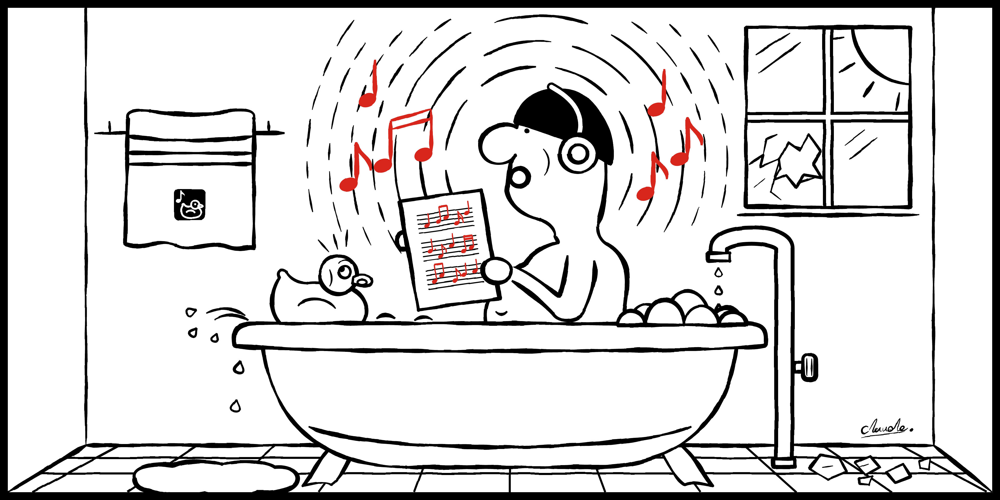
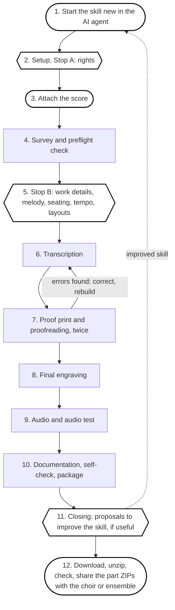

<p><a href="https://practice-duck-plugin.pages.dev/en/"></a></p>

# Practice Duck

<p><picture><source media="(prefers-color-scheme: dark)" srcset="img/header-dark.png"></picture></p>

English | [Deutsch](README.de.md)

## One score. Practice material for every part.

This is primarily a code experiment.

The project documents an AI music workflow as a Claude plugin. Given the score of a **choir or an instrument ensemble** (PDF, scan, photo, MusicXML or export from notation software), the plugin produces one ZIP with **scores and MP3 recordings for every part**: in three stages (solo, with accompaniment, together with the other parts) and in two sounds (choir or instrument, and piano). The AI agent transcribes the score, proofreads it twice and checks the audio technically. Twelve skills cover the whole route: from the first run to corrections, transposing and handing over.

**Contents**

[A. Overview: what does it do?](#a-overview-what-does-it-do)<br>
[B. Start: how to begin?](#b-start-how-to-begin)<br>
[C. Requirements: what is needed?](#c-requirements-what-is-needed)<br>
[D. Rights: what does the skill ask?](#d-rights-what-does-the-skill-ask)<br>
[E. Workflow: which steps are there?](#e-workflow-which-steps-are-there)<br>
[F. Flexibility: is the workflow binding?](#f-flexibility-is-the-workflow-binding)<br>
[G. Result: what comes out?](#g-result-what-comes-out)<br>
[H. Audio mix: how are the recordings mixed?](#h-audio-mix-how-are-the-recordings-mixed)<br>
[I. Limits: what can’t it do?](#i-limits-what-cant-it-do)<br>
[J. AI marking: how is AI content marked?](#j-ai-marking-how-is-ai-content-marked)

## A. Overview: what does it do?

One ZIP with
- practice audio (MP3) and MIDI per part: solo, with accompaniment, in the choir or ensemble, plus tutti; in choir or ensemble sound and in piano sound; normal and slowed down
- tags in every MP3 and one album cover per piece, the same for all parts (colours derived from key, mode, tempo and metre)
- one ready-made ZIP per part, a guide for the director of the choir or ensemble, a check log and a correction log
- a start page (`Start.html`) in the delivery folder and in every part folder: structure with links, the chosen layouts with previews and, in every part folder, two players (list of the recordings with the cover, headphones). It works with a double click, no server needed

The exact structure of the ZIP is shown in section [G](#g-result-what-comes-out).

**Choir and instruments.** The same route serves mixed choirs, other vocal ensembles and instrument pieces: string quartet, woodwind quintet, brass quintet, a solo singer or solo instrument with piano, or your own ensemble. Transposing instruments (clarinet in B♭, horn in F and others) are printed in written pitch, the recordings sound at concert pitch. A printed piano or organ accompaniment is carried along and drafted from the parts if the score has none. A piece for instruments is delivered as `Instrument_Practice_<Title>`, a choir piece as `Practice_<Title>`.

**The skills of the plugin**

| Skill | What it does |
|---|---|
| `new` | The whole route from the score to the finished ZIP, with two stops where you decide (rights; title, parts, tempo, layouts) |
| `setup` | Checks and installs the tools (audio, notation, PDF) |
| `rights` | Clarifies the rights of a score before anything is made |
| `profile` | Keeps recurring wishes (audio, package, documents) in a profile, set up on a start page |
| `ensemble` | Creates or changes the ensemble: parts, clefs, instruments, transposition, from a template |
| `import` | Starts from a MusicXML file or from photos instead of a PDF scan |
| `adapt` | Transposes a finished piece or moves it to another ensemble |
| `correct` | Corrects single bars or parts and rebuilds the piece |
| `check` | Checks a finished package: check log and listening list |
| `deliver` | Packs the package for handing over: paper format, language, ZIP per part |
| `continue` | Continues a run from its session handoff file |
| `help` | Explains the plugin and finds the cause of a problem |

## B. Start: how to begin?
1. Download `practice-duck.plugin` from the [latest release](https://github.com/vbth/practice-duck-plugin/releases/latest).
2. Install it: upload the file `practice-duck.plugin` in Claude (plugin settings). Unsure about anything? Ask the skill `help`: it explains the plugin and finds the cause of a problem.
3. Start the skill `new`. It begins with the skill `setup`, which checks the tools (audio, notation, PDF) and, after one question from you, installs what is missing; you can also run `setup` on its own first.
4. Attach the score (PDF, photo, scan, MusicXML or export). The other skills are called when needed, or by name.
5. Answer the questions: rights first (Stop A), then title, melody part, seating, tempo and layouts (Stop B).
6. Download the finished ZIP, unzip it and open `Start.html`.

Requirements and rights: [C](#c-requirements-what-is-needed) and [D](#d-rights-what-does-the-skill-ask). The steps in detail: [E](#e-workflow-which-steps-are-there).

## C. Requirements: what is needed?
Python with the packages the plugin lists, FluidSynth, ffmpeg, poppler and a soundfont (a fallback is used and reported). At the start the skill checks the installation. If something is missing or different, it lists what it would install and asks: the **tested versions** (recommended) or the **newest versions**. The versions used are recorded in the check log; newest versions are marked as not tested.

**Sound.** The audio is rendered with a soundfont: MuseScore General (installed by the skill `setup`, the default) or, on request, **GeneralUser GS 2.0.3 (beta)**, which is included in the plugin. GeneralUser GS is by S. Christian Collins ([original source](https://www.schristiancollins.com/generaluser.php), [repository](https://github.com/mrbumpy409/GeneralUser-GS)) and may be used for private and commercial music production under its own licence. To fit the upload limit the skill carries it **compressed to the SF3 format** (Ogg Vorbis, 7 MB instead of 32 MB, lossy); presets and licence text are unchanged. Details in [`THIRD_PARTY_NOTICES.md`](THIRD_PARTY_NOTICES.md).

## D. Rights: what does the skill ask?
Before it processes a score, the skill asks whether the score is **public domain, licensed, the user’s own work or unclear**, and notes the answer in the README of the package. It gives no legal advice, does not check the answer and grants no rights. Whether a score may be processed and passed on depends on its copyright and licence, and the responsibility lies with the user. The licence of the plugin ([`LICENSE.md`](LICENSE.md)) says nothing about the rights to the score.

## E. Workflow: which steps are there?

If a check fails, the AI agent fixes the problem and checks again, up to three times. If it still fails, the AI agent stops and reports what went wrong, why, and what the options are.

<details>
<summary><h3>Steps in detail: who does what, what is checked</h3></summary>

| No. | Step | Who does what | Check at the end |
|--:|---|---|---|
| 1 | Start | The skill `new` is started; it begins with `setup`. | None |
| 2 | Setup, Stop A | The AI agent checks the tools and, if something is missing, asks whether to install the tested or the newest package versions. Then the rights status is stated. | All tools ok? |
| 3 | Attach score | The score is attached. Optionally the settings file of an earlier run (`<date>_Settings_<Title>.md`) is attached too; its settings are taken over, and the AI agent asks again only where they contradict the score. The rights are always asked again. | None |
| 4 | Survey | The AI agent reads the pages, checks the scan quality and compares it with the stated rights. | Structure understood, scope announced? |
| 5 | Stop B | In five levels from the general to the specific (purpose, piece and parts, sound and tempo, scores, the rest): title, melody part, seating and tempo are approved, adjustments chosen (transposing, four parts from two), the layouts of the sheets chosen (with a coloured part marking: red, blue or orange). The AI agent proposes from what it measured, for example a shift when a part lies outside its range. | None |
| 6 | Transcription | The AI agent turns the score into data and MusicXML. | Score builds without errors? |
| 7 | Proofreading | The AI agent engraves a proof print and compares it with the source: pitches and rhythm first, then lyrics, then signs, arcs and articulation (catalogue of all notation signs, comparison sheet scan against score, automatic comparison of the signs read with the score). | All passes clean, findings resolved? Otherwise back to step 6. |
| 8 | Final engraving | The AI agent engraves the corrected DIN A4 score with a cover page and the chosen layouts. | Readable, pages filled, looked at? |
| 9 | Audio | The AI agent creates MP3 and MIDI with tags and album cover and checks them technically (duration, gaps, clipping, loudness, stereo). | All files present, spot check done? |
| 10 | Package | The AI agent writes the documents, including the settings file (every assumption and decision with its origin: user, AI agent, file or default), adds the start pages (`Start.html`, with two players in every part folder), checks itself and packs the ZIP with the part ZIPs. | Package check passes, ZIPs tested? |
| 11 | Closing | The AI agent proposes improvements to the skill if useful. The user decides. | None |
| 12 | Download | The ZIP is downloaded and unzipped, `Start.html` opened and checked, the part ZIPs go to the choir or ensemble. The settings file is kept to repeat the result. | None |

</details>

<details>
<summary><h3>Notation elements: what is read, checked and set</h3></summary>

**Process.** The AI agent reads the source bar by bar and writes pitches, durations, lyrics and signs into the score data; MusicXML, the proof print and the final score are built from it. Proofreading then runs in four passes: pitches and rhythm, lyrics, signs and lyric order, and signs and arcs. For the signs the AI agent first lists every sign it sees in the source (system by system, part by part, using the catalogue below) in a list, and only then does the plugin compare that list with the built score and add what is missing. Everything the skill cannot set is written down as `other` and ends up in the open points of the README; nothing is left out silently.

| Family | Read, checked and set | Printed as text only | Not supported (reported) |
|---|---|---|---|
| **Staff, clef** | treble, bass, alto, tenor and treble-8vb clefs, clef changes, ledger lines | | octave lines 8va/8vb/15ma |
| **Key, metre** | key signature and key changes, accidentals (♯ ♭ ♮ 𝄪 𝄫), time signatures and changes, ¢ and C as numbers, pickup bar, bar numbers | | mixed or alternating metres, restart of the numbering, courtesy accidentals |
| **Notes, rests** | note values from whole to 32nd (double dots up to the eighth; other lengths are written as tied notes), dots, rests, tuplets (one group at a time), grace notes before the main note (slashed or not), unison, beams and stems (automatic) | divisi, a 2, unisono | multi-bar rests and cue notes in the source (the part sheets can create both as entry aids), nested tuplets, grace notes after the note, ossia, special note heads (x, diamond), notes shorter than a 32nd |
| **Arcs** | tie, dotted tie, slur, dotted slur, arcs across barlines and system breaks, portato | arc under the text (Elision) | phrase marks over slurs, half ties (laissez vibrer) |
| **Articulation, breath** | staccato, tenuto, accent, marcato, breath mark, caesura, fermata | | staccatissimo, fermata on the barline, glissando and portamento |
| **Dynamics, expression** | pppp to ffff, sf and sfz and similar, fp and similar, hairpins, cresc. and dim. (the audio ramps), chord symbols, part labels (Solo, Tutti, S. A. T. B.) | subito, poco a poco, dolce, espressivo and other words | Roman numerals, figured bass |
| **Tempo** | tempo word, metronome mark, tempo changes (rit., accel., new metronome number; the audio follows as approved at Stop B) | rit. on a single note, attacca, segue | |
| **Ornaments** | trill, mordent, turn (played with the option `ornaments`) | | inverted mordent, slide, tremolo, arpeggio, vibrato |
| **Repeats, jumps** | repeat signs, 1st and 2nd endings, D.C., D.S., segno, coda, fine (as words plus playback), barlines | | nested repeats (written out with `playback`), bar repeat `%`, dashed barlines |
| **Text, singing** | syllables, hyphens, extender lines, verse numbers, refrain, part-specific lyric lines, punctuation as printed | humming, vocalise | speech, whisper, clapping |
| **Page** | title block, copyright notice, rehearsal letters | | fingering and pedal, piano reduction, page-turn marks, footnotes |

**What the audio and MIDI follow:** dynamics (levels), hairpins and cresc./dim. words (ramps), tempo marks and tempo changes (as approved at Stop B), repeats, endings and the playback order, fermatas (the note is held), grace notes (on the beat), ornaments, and, with the option `articulation_audio`, breath marks, caesuras, staccato, tenuto, accents and the small gaps between syllables. Everything else (chord symbols, rehearsal letters, part labels, other words) is printed only.

Handwritten entries (pencil, circles, breath marks added by hand) are never music: they are reported as an open point, never transcribed. Special notation (aleatoric, clusters, microtones, graphic scores, neumes, tablature, figured bass) is always reported and never transcribed; at Stop B the skill asks whether such a piece should be made at all. The check log lists the passes and their findings.

</details>

## F. Flexibility: is the workflow binding?
The workflow is a tested proposal, not a fixed order. If another way gives a better result for a score, the AI agent may take it; it may also be requested. What stays fixed is the outcome:

- the rights question is asked and noted in the README,
- everything is marked as created with AI assistance,
- the notation is proofread against the source,
- the technical checks (package check) pass for all files, however they were made.

Every deviation is written to the correction log and the session handoff with its reason; checks that were skipped are named there. A better way is proposed in step 11 (Closing) for the next version.

## G. Result: what comes out?
MP3 titles, file names, PDFs and logs follow the language of the conversation (German and English built in, see [README.de.md](README.de.md)). One ZIP, named like the top folder:

<details>
<summary>Folder structure of the ZIP</summary>

The tree shows a choir piece. An instrument piece is named the same, with the sound folder `Ensemble_Sound` and the third stage “In the ensemble”. Where one instrument sounds alone (alone, with accompaniment), the file name carries its real name, for example `1_Fl_<Title>_Flute_alone_slow.mp3`.

```text
Practice_<Title>/
├─ Start.html                       (structure with links, layouts with previews of the piece; open it with a double click)
├─ 1_Scores/
│  ├─ 1_Score_<Title>_Scan.pdf
│  ├─ 2_Score_<Title>.pdf
│  ├─ 3_MusicXML_<Title>_Choir.musicxml
│  ├─ 4_MusicXML_<Title>_Piano.musicxml
│  ├─ 5_Layouts_<Title>/            (only the chosen layouts, grouped by part: <abbr>/04_<abbr>_Layout_…/<abbr>_Score_<Title>_L04.pdf)
│  └─ 6_MIDI_<Title>/
│     ├─ S_MIDI_<Title>/           (one per part: S, A, T, B; ten files)
│     └─ Tutti_MIDI_<Title>/       (choir and piano)
├─ 2_Practice/
│  ├─ 1_Overview.pdf
│  ├─ 2_Guide.pdf
│  └─ S_Practice_<Title>.zip       (one ZIP per part, ready to pass on)
│        ├─ 1_S_Guide.pdf
│        ├─ 2_S_Layouts_<Title>/             (the chosen layouts of this part, one folder per layout; later numbers move up if none)
│        ├─ 3_S_Score_<Title>.pdf
│        ├─ 4_S_Audio_Choir_Sound_<Title>/   (six MP3: solo, with piano, each slow and normal; own part louder; all parts equal)
│        ├─ 5_S_Audio_Piano_Sound_<Title>/   (the same six)
│        └─ Start.html                       (this part: structure, layouts, two players: list with cover, headphones)
├─ 3_Documentation/
│  ├─ 1_README_<Title>
│  ├─ <date>_Settings_<Title>.md
│  ├─ 2_Check_Log_<Title>
│  ├─ 3_Correction_Log_<Title>
│  └─ 4_Session_Handoff_<Title>.md
└─ 4_Tools/
   ├─ 1_Project_Data_<Title>/                 (the data files of the piece)
   └─ 2_PLUGIN_practice_duck_v<Version>/      (practice_duck.plugin)
```

</details>

<details>
<summary>Layouts: what can be chosen at Stop B</summary>

Layouts are made on request, nothing by default. At Stop B, four things are chosen, each freely combinable: the **sheet structure** (full score as in the source with its own number of parts per staff, or one sheet per part), the **part marking** (none, own part in colour, or own part black with the others light grey, in the full score) and the **verse guide** for several verses (none, thin line or grey band; the verse number stands at every system start) and, for the part sheets, **entry aids** (none, multi-bar rests with the number of bars, or also small cue notes of another part before the entrance). Each combination is a numbered PDF (1 to 12, the number is in the footer); the part folders get their own, the director's folder gets all. The example package shows every layout.

**Adjustments.** If a part lies outside its usual range, the AI agent proposes to transpose the whole piece by a number of semitones (notes, key signature, chord symbols and audio follow). A two-part piece can be made for four parts by octave doubling: tenor and bass sing the upper and lower line an octave lower; no notes or harmony are added. Both are applied after proofreading, the source stays as a separate copy, the README states the change. With a licence or permission the permission must cover an adaptation.

The marking colour is asked at Stop B, right after the layouts: red (default), blue or orange. Red can be hard to tell from black with red-green colour blindness; blue and orange stay clearly apart.

<p><br>Red <code>#D9251D</code> (default) · Blue <code>#0072B2</code> · Orange <code>#D55E00</code></p>

</details>

## H. Audio mix: how are the recordings mixed?
Each part gets its **own mix**. The own part is always centred, and the other parts are panned to match the seating of the choir or ensemble, so headphones recreate the row. It sounds best on **headphones**.

- **Solo:** own part only.
- **With accompaniment:** own part, melody −4 dB, piano accompaniment of all parts −12 dB.
- **In the choir** (instrument pieces: **in the ensemble**): neighbours left and right −7 dB; a part at the edge of the seating also gets the next-but-one part on its free side at −9 dB; the rest −12 dB.
- **Tutti:** all parts at equal level.
- Every recording starts with the part’s starting note, then a short pause. Solo and with accompaniment also exist at a slower tempo (default 75 %, adjustable).
- Loudness −19 LUFS, light room reverb; the MIDI files carry the same volume and pan values.
- The overview PDF generated for every piece (`2_Practice/1_Overview.pdf`) shows the mixes (dot size = level, position = left/right).

## I. Limits: what can’t it do?
- The AI agent does not hear the audio; it is tested technically (duration against the MIDI, gaps, clipping, loudness, stereo). Sound and taste are not judged.
- Accidentals and rhythm are read from image crops and proofread twice, not measured. Signs and arcs are read from the crops as well; the automatic check compares two readings and cannot find a sign that was misread the same way twice. Cue notes, tremolo, arpeggio and similar signs are reported but not transcribed. Tuplets, grace notes, chord symbols, rehearsal marks, clef changes and tempo changes (rit., accel., new metronome marks) are transcribed (chord symbols and rehearsal marks are printed, the audio does not use them); the audio follows tempo changes and, on request, articulation (breath marks, staccato, tenuto, accents, syllable gaps, ornaments) only as far as they were approved.
- Repeats, endings and playback order are tested on small trial scores only; spot-check real pieces. D.C./D.S./coda are not engraved as signs.
- DIN A4 only. US Letter is currently not supported.

### Scan quality
The page check aborts below a staff space of 8 px and warns below 12 px. It was tried on drawn test pages only, not on real scans, so the limits are not calibrated and very blurred, tilted or noisy photos may be rejected.

## J. AI marking: how is AI content marked?
Everything the skill creates is marked as created with AI assistance: the EU label "AI" and the note "Created with AI assistance." in the footer of every PDF, preceded by the year (never a full date), and the same note in the metadata of MP3, MIDI, MusicXML and PDF. The music itself does not come from the AI: the notes follow the source, the sound is software synthesis, and the AI helps to read, proofread and run the tools. Compare the notes and the music with the source before use. The label follows the European Commission's icons for labelling AI-generated content (see [`THIRD_PARTY_NOTICES.md`](THIRD_PARTY_NOTICES.md)).

<picture><source media="(prefers-color-scheme: dark)" srcset="img/ai-basic-dark.svg"></picture> 2026 Created with AI assistance. [PolyForm Noncommercial License 1.0.0](https://polyformproject.org/licenses/noncommercial/1.0.0).

